# REGISTA simulator calibration

40 unscripted matches between random clubs of the fictional league (seed 7, `regista-sim calibrate --matches 40`), compared with the plausibility ranges of `docs/DATA_AND_METRICS.md` §7. Values are means over 80 team-matches; the histograms show the per-team-match spread.

**Result: 15 / 15 metrics in range (100%) — PASS** (required: ≥ 90%).

| Metric (per team per match) | Range | Mean | Std | In range | Histogram |
|---|---|---|---|---|---|
| Passes attempted | 350.00 – 650.00 | 443.55 | 72.62 | ✅ | 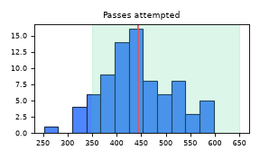 |
| Pass completion | 75.0% – 90.0% | 85.0% | 2.8% | ✅ | 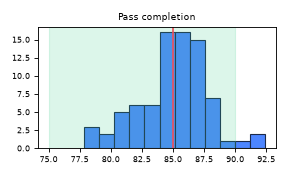 |
| Shots | 8.00 – 20.00 | 14.61 | 5.61 | ✅ | 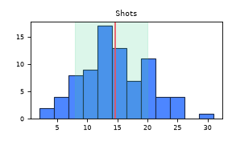 |
| Shots on target / shots | 30.0% – 40.0% | 33.6% | 12.5% | ✅ | 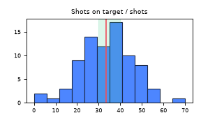 |
| Goals | 1.20 – 1.70 | 1.25 | 1.05 | ✅ | 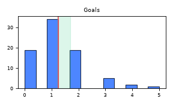 |
| Mean xG per shot | 0.090 – 0.130 | 0.091 | 0.026 | ✅ | 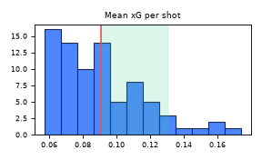 |
| Possession | 35.0% – 65.0% | 50.0% | 6.5% | ✅ | 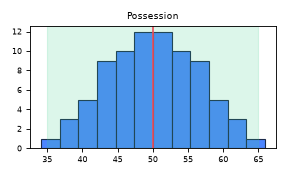 |
| Fouls | 8.00 – 14.00 | 8.68 | 3.54 | ✅ | 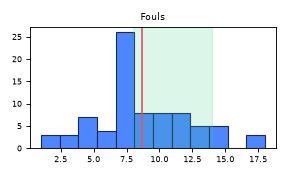 |
| Corners | 3.00 – 8.00 | 3.80 | 2.89 | ✅ | 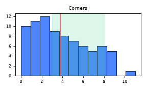 |
| Yellow cards | 1.00 – 3.00 | 1.76 | 1.33 | ✅ | 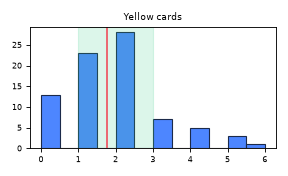 |
| Distance per outfield player (90′) | 9.50 – 12.00 | 10.88 | 0.388 | ✅ | 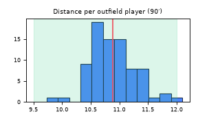 |
| Sprints (≥ 25.2 km/h) per outfield player | 15.00 – 40.00 | 19.97 | 5.89 | ✅ | 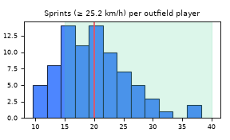 |
| Top speed per match (fastest player) | 32.00 – 36.00 | 34.23 | 0.491 | ✅ | 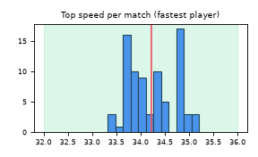 |
| Pass ball speed | 30.00 – 90.00 | 43.81 | 1.60 | ✅ | 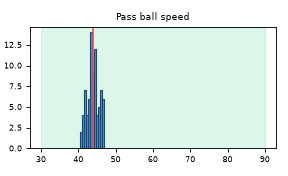 |
| Shot speed | 60.00 – 130.00 | 97.42 | 3.20 | ✅ | 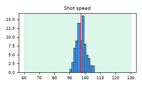 |

Notes: xG is the simulator's true goal model (ground truth), not the Phase 2 analytics model; physical metrics come from 10 Hz tracking with the §8 formulas (5-frame centred speed average, sprints ≥ 25.2 km/h for ≥ 1 s), normalised to 90 minutes per player. `baselines.json` also holds the means and standard deviations of the control-vs-chaos components over 5-minute windows and of their weighted sum, which scales the chaos index so free play averages 50 with 15 points per standard deviation (label mix in free play: control 12%, contested 73%, chaos 14%).
