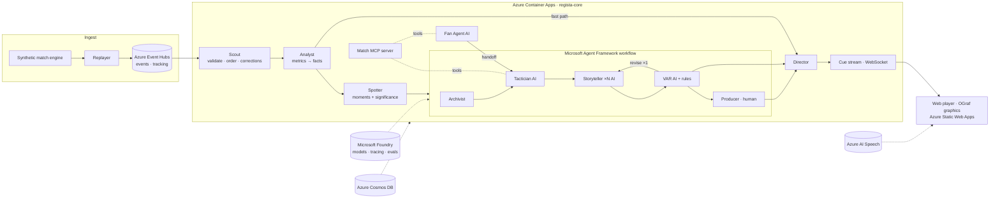

# REGISTA — Architecture

Visual version: slide 2 of `docs/design/regista-vision.html`.

## 1. Overview


Two speeds:
- **Fast path** (deterministic, < 300 ms): Analyst → Director. Speed tags, pass cards, scorebug,
  win-probability chip, pulse widget. No model involved.
- **Story path** (agents, p95 < 4 s): Spotter → Archivist → Tactician → Storyteller×N → VAR →
  Director. "Why it matters" cards, commentary lines, audio description, recaps.

## 2. Components
| Component | Runs in | Responsibility |
|---|---|---|
| `regista_sim` | CLI / Container Apps job | League generator, match engine, golden scenario, calibration, dataset export |
| Replayer | core (`bus/replayer.py`) | Reads a match folder, publishes events + tracking batches with timing; controls: start, pause, seek(minute), speed |
| Bus | core (`bus/`) | `MemoryBus` (local) and `EventHubsBus` (cloud) behind one interface; checkpoints in Blob Storage |
| Scout | core | JSON-schema validation, dedupe by `event_id`, ordering by `(period, clock_ms, seq)`, applies `data_correction` events |
| Analyst | core | Maintains `MatchState`; computes metrics and emits typed `Fact`s; threshold triggers |
| Spotter | core | Groups facts into `Moment`s, scores significance, enforces the model budget |
| Agents | core (`agents/`) | Agent Framework workflow (see §4) |
| Director | core | Chooses OGraf graphic + timing per segment, dead-ball windows, priority, corrections |
| API | core (`api/`) | REST + WebSocket `/ws/feed`, producer endpoints, catch-up, ask |
| MCP server | core (`mcp_server/`) | Match-data tools for agents (and for any MCP client during the demo) |
| Web | Static Web Apps | Fan view, split view, producer console, profile, about |

## 3. Agent roster
| Agent | Kind | Model | Input → Output | Budget | Fallback |
|---|---|---|---|---|---|
| Scout | code | — | raw event → validated event | 1 ms | drop + dead-letter log |
| Analyst | code | — | event/tracking → facts | 5 ms | — |
| Spotter | code | — | facts → `Moment` (+score) | 1 ms | — |
| Archivist | code (+ optional phrasing) | — | moment → milestone/record facts from career history | 10 ms | skip |
| **Tactician** | AI agent with MCP tools | `MODEL_SMART` | moment + facts → `EvidencePack` (headline, ≤3 claims with fact IDs, context, confidence) | 2.0 s | template evidence pack from facts |
| **Storyteller** | AI agent, one call per segment, concurrent | `MODEL_FAST` | evidence pack + segment → `SegmentDraft` (overlay_short ≤ 90 chars, overlay_long ≤ 220, commentary_line, ad_line, fact_ids per field) | 1.5 s | localized template (EN/FR/ES/AR) |
| **VAR** | rules + AI judge | `MODEL_FAST` (long-form only) | draft + facts → `Verdict` (approve / revise(feedback) / reject) | 5 ms rules, 1.0 s judge | reject → template |
| Director | code | — | approved drafts + facts → `Cue`s per segment | 2 ms | — |
| **Fan Agent** | AI agent with MCP tools | `MODEL_FAST` | question or time window + profile → answer / recap with fact IDs | 3 s | "Here's what the data shows…" template |
| Producer | human (HITL) | — | broadcast-segment cue → approve / edit / reject | auto-approve 8 s | auto-approve (configurable) |

### Prompt skeletons (store in `agents/prompts/*.md`, keep static parts first for caching)
**Tactician** — "You are Tactician, an expert football analyst for a live broadcast. Explain why
this moment matters. Use ONLY the facts provided and the MCP tools. Output JSON (schema given).
Every claim lists the `fact_ids` it relies on. No speculation, no injuries, no referee criticism,
no betting. At most 3 claims. Prefer cause → consequence (e.g. pressing shift → space → goal)."

**Storyteller** — "You write live broadcast text for segment {language}/{expertise}/{allegiance}/{mode}.
Write natively in {language} (not a translation). Use ONLY facts from the evidence pack; every
number and name you write must appear in a fact and be listed in `fact_ids`. Respect lengths.
Tone: {tone}. For partisan segments, speak as a supporter of {club}, passionate but respectful.
Format numbers for {locale}. Output JSON (schema given)."

**VAR judge** — "You are VAR, a strict fact-checker. List every claim in the draft. Mark each
SUPPORTED / UNSUPPORTED / CONTRADICTED with the fact_id. Check the editorial policy. Return
approve, or revise with one-sentence feedback, or reject."

## 4. Workflows (Microsoft Agent Framework)
Verify current APIs with `microsoft-learn` before coding (graph workflows, executors, edges,
concurrent fan-out, handoff, human-in-the-loop requests, checkpoint storage).

**Moment workflow** (one run per moment, checkpointed):
1. `Archivist` (executor) adds milestone/record facts.
2. `Tactician` (agent) → `EvidencePack`.
3. Fan-out: one `Storyteller` run per **active segment**, concurrently.
4. Per draft: `VAR` rules → (long-form only) VAR judge → `revise` loops back to that Storyteller
   once with feedback → still failing → template fallback (marked `degraded`).
5. `Director` builds cues. Broadcast-segment cues go to the Producer via a human-in-the-loop
   request; fan segments publish immediately.
6. Persist moment, evidence pack, verdicts, cues and timings (audit trail) to Cosmos DB.

**Recap workflow** (half time, full time): Archivist → Tactician (match story arcs) → Storyteller
per segment (recap, 60–90 s of speech) → VAR → Speech.

**Catch-me-up workflow**: input = profile + `[from_ms, to_ms]` → top moments in window → Fan Agent
writes a 30-second recap → VAR rules → Speech.

**Ask-the-Pundit workflow**: Fan Agent answers with MCP tools; for "why"/tactical questions it
hands off to Tactician (Agent Framework handoff pattern), then VAR rules check the answer.

## 5. Shared state and contracts (pydantic, `regista_core/models/`)
- `Event`, `TrackingFrame` — see `DATA_AND_METRICS.md` §4–§5
- `MatchState` — score, clock, possession, per-team and per-player accumulators, rolling windows
- `Fact` — `id, kind, subject, value, unit, window, source_event_ids, renderings`
- `Moment` — `id, type, minute, video_ts_ms, fact_ids, significance, involved_players, team`
- `EvidencePack` — see `DATA_AND_METRICS.md` §11
- `Segment` — `language, expertise, allegiance, mode` → `segment_id` like `fr|casual|KBA|standard`
- `SegmentDraft`, `Verdict`, `Cue`, `Profile`, `AgentRun` (timings, tokens, cost, status)

Agents never read each other's prompts; they communicate only through these typed objects and the
facts store. That is the "shared state" the Multi-Agent judges look for.

## 6. LLM gateway (`regista_core/llm/gateway.py`)
`call(agent, model, messages, schema, timeout_s, cache_key=None) -> T | Fallback`
- Modes: `template` (never calls a model), `cache` (replays recorded outputs; misses → template),
  `live` (calls Foundry; records to cache).
- Timeout + 1 retry with jitter; circuit breaker per agent (open after 3 consecutive failures,
  half-open after 20 s).
- Structured output: JSON schema → pydantic validation; invalid → retry once with the error.
- Accounting: tokens in/out, cost (price table in `llm/prices.py`), latency → OpenTelemetry span
  attributes + `AgentRun` record.
- Budget guard: daily USD cap (`DAILY_LLM_BUDGET_USD`) → automatic switch to `cache`/`template`.
- Reasoning models: use the lowest reasoning effort for live calls; if p95 > 2.5 s, switch
  Storyteller to a non-reasoning mini model.
- Chaos hook: `CHAOS_STOPPED_AGENTS` (set from the producer console) makes the gateway raise for
  that agent, to demonstrate fallback and recovery.

## 7. Overlay protocol
**Cue (`regista.cue.v1`)** — pushed over `/ws/feed?segment=…` (and stored):
```json
{
  "schema": "regista.cue.v1",
  "cue_id": "c-00412",
  "match_id": "m001",
  "segment_id": "fr|casual|KBA|standard",
  "moment_id": "mo-017",
  "graphic": "regista-why-card",
  "action": "play",
  "data": { "kicker": "Pourquoi c'est important · 67′", "headline": "…", "body": "…", "facts": [{"id": "f-884", "label": "Victoire 26 % → 9 %"}], "verified": true },
  "timing": { "video_ts_ms": 4029000, "duration_ms": 9000, "dead_ball_preferred": true },
  "priority": 80,
  "layer": "lower-third",
  "lang": "fr",
  "a11y_text": "…",
  "audio_url": null,
  "evidence_ref": "mo-017",
  "degraded": false,
  "supersedes": null
}
```
`action` ∈ `load | play | update | stop`. Corrections use `update` or `stop` + a new cue with
`supersedes`.

**OGraf graphics** (`apps/web/public/ograf/<id>/`, one manifest `*.ograf.json` + one ES module):
`regista-scorebug`, `regista-wp-chip`, `regista-pulse`, `regista-name-tag`, `regista-pass-card`,
`regista-shot-card`, `regista-why-card`, `regista-lower-third`, `regista-player-focus`.
Follow the OGraf v1 spec exactly (https://ograf.ebu.io): manifest file name ends with
`.ograf.json`, `$schema` points to the v1 graphics schema, `main` points to the module exporting
the Web Component, `schema` describes the `data` accepted by `load()` / `updateAction()`.
Write a test that validates every manifest against the official JSON schema and every cue's `data`
against its graphic's `schema`.

**Director rules**: layers (scorebug persistent; one lower-third; one side card; up to two tags;
pulse persistent), min gap 6 s between side cards, duration 7–10 s by length, pre-empt only if
priority differs by ≥ 30, non-urgent cards wait for the next stoppage (max 20 s), density per
persona (analyst: all; casual: priority ≥ 50; audio description: audio-first, minimal visuals;
player focus: every focus-player cue + priority ≥ 70).

**Spoiler-safe client scheduler**: each viewer has `viewer_delay_ms`. The pitch renders buffered
tracking at `playback_ts = live_ts − viewer_delay_ms`; a cue is shown only when
`cue.timing.video_ts_ms ≤ playback_ts`. A delayed viewer never sees a goal card before the goal.

## 8. Personalization
- `Profile`: language, locale, expertise (`casual|enthusiast|analyst`), mode
  (`standard|player_focus|audio_description|kids`), favourite clubs and players, focus player,
  metric lens (`xg|pressing|speed|passing|none`), tone (`neutral|partisan`), density, accessibility.
- `Segment` = (language, expertise, allegiance, mode). Storyteller runs once per **active**
  segment. The client fills edge slots (focus-player stats, metric-lens chip, locale formatting)
  from facts. Cost scales with segments, not fans.

## 9. Resilience matrix
| Failure | Detection | Behaviour | Demo |
|---|---|---|---|
| Model timeout / error | gateway timeout, exception | retry once → template (marked `degraded`) | Chaos test in producer console |
| Agent repeatedly failing | circuit breaker | skip agent for 20 s, templates | Console shows breaker state |
| VAR rejects twice | verdict | template for that segment | VAR log |
| Core crash / redeploy | Event Hubs checkpoint | resume from last processed offset; idempotent by `event_id` | Restart during rehearsal |
| Workflow interrupted | Agent Framework checkpoint | resume moment run | — |
| Data correction | `data_correction` event | recompute facts; Director emits `update`/`supersedes` | 65′ correction |
| Budget exceeded | gateway budget guard | switch to cache/template | Console banner |
| Speech failure | exception | captions only | — |

## 10. Observability and evaluation
- OpenTelemetry (Agent Framework emits GenAI spans) → Application Insights; connect the Foundry
  project to the same Application Insights to browse agent traces in Foundry.
- Custom metrics: event→cue latency (fast and story paths), VAR rejection rate, fallback count,
  tokens and USD per moment and per match.
- `evals/`: offline evaluation on the golden match — factual consistency (our checker), Azure AI
  evaluators for groundedness/relevance/fluency per language, latency percentiles, cost. Write
  `evals/report.md` and surface the headline numbers in the README.

## 11. Security
- Managed identity for the core app; RBAC roles: model access on the Foundry resource
  (Cognitive Services OpenAI User or the role Foundry recommends — verify), Event Hubs Data
  Sender/Receiver, Storage Blob Data Contributor, Cosmos DB built-in data contributor.
- Speech / Content Safety keys as Container Apps secrets if Entra auth is impractical.
- Public demo: judge mode is read-only; live generation requires `DEMO_ACCESS_CODE`; per-IP rate
  limit; CORS restricted to the web origin; secret scanning in CI.

## 12. Azure resources
| Resource | SKU | Purpose |
|---|---|---|
| Microsoft Foundry resource + project | pay-as-you-go | models (`gpt-5-mini`), tracing, evaluations |
| Event Hubs namespace | Basic, 1 TU | hubs `events`, `tracking` (1-day retention) |
| Storage account | Standard LRS | Event Hubs checkpoints, dataset, audio cache |
| Cosmos DB for NoSQL | free tier | moments, cues, profiles, agent runs |
| Container Registry | Basic | core image |
| Container Apps environment + app | Consumption, 0.5 vCPU / 1 GiB | regista-core |
| Static Web Apps | Free | web |
| Azure AI Speech | F0 → S0 if throttled | TTS |
| Azure AI Content Safety | F0 | VAR checks |
| Log Analytics + Application Insights | pay-as-you-go | logs, traces |

## 13. Why multi-agent (README section)
1. **Independent verification**: a model shouldn't grade its own claims; VAR is a separate agent
   with its own rules and prompt.
2. **Latency**: Storytellers for each segment run in parallel; one agent writing four languages
   sequentially would miss the budget.
3. **Right tool per job**: code where numbers must be exact, models where language must be
   natural, a human where editorial control is required.
4. **Failure isolation**: one failing agent degrades one output, not the broadcast.
5. **Cost**: small models for high-volume roles, a stronger model only where reasoning matters.
